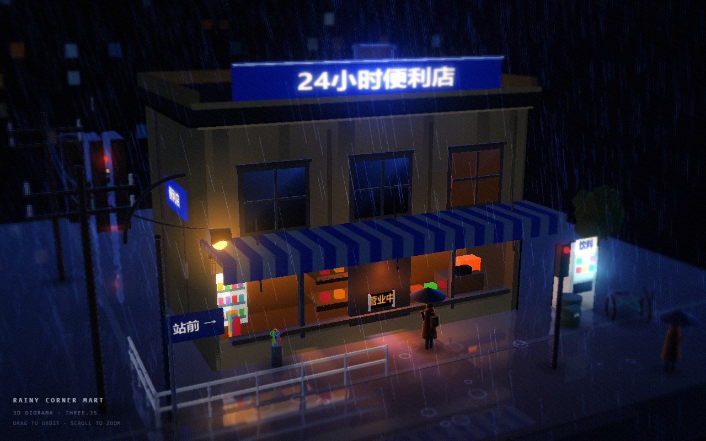
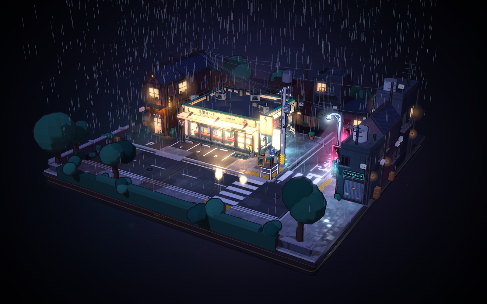

# 🌧️ Rainy Night Dioramas

**English** | [简体中文](README.zh-CN.md)

Two self-contained rainy-night 3D dioramas built with [Three.js](https://threejs.org) **r160** — a corner convenience store, and a full city block at 3 a.m.

Everything you see is generated at runtime. Geometry, signage, paving, puddles, window grids, rain — all procedural. There are **no image files, no model files, no CDN requests, and no build step**.


---

## 🏙️ The two scenes

| | Scene | Entry point | Size | Needs a server? |
|---|---|---|---|---|
| 🌃 | **Rainy Corner Mart** — one street corner, one store, one person waiting out the rain | [`rainy-conbini/index.html`](rainy-conbini/index.html) | ~72 KB HTML + vendored Three.js | Yes (ES modules) |
| 🌆 | **Hoshifuri Mart** — a whole block: store, parking lot, crosswalk, traffic lights, power lines | [`hoshifuri-mart/index.html`](hoshifuri-mart/index.html) | ~1.0 MB, single file | No — just open it |

### 🌃 Rainy Corner Mart



A tight, cinematic corner: a two-storey storefront, a striped awning, a wet road, and a figure with an umbrella standing in the light spilling out of the window.

**Techniques**

- **Custom cel shader** — three-band hard-edged shading instead of `MeshToonMaterial`, with cold blue-violet shadows (never pure black), a distance-attenuated warm term that lets the store's light bleed onto the surrounding walls, fresnel rim light, manual distance fog, and low-frequency grime modulation to break up flat wall colours.
- **Post-processing chain** — `EffectComposer` → `UnrealBloomPass` → a custom final pass doing radial chromatic aberration, **tilt-shift blur** (the miniature-photography look), highlight rolloff, cool/warm split toning, an S-curve, vignette and film grain.
- **Planar mirror reflection** — a mirrored virtual camera renders the scene into a 1024² target, projected back onto the road through a projective texture matrix, masked by a wetness map and smeared vertically to read as wet asphalt rather than a mirror.
- **Rain** — `LineSegments`, 3,200 near streaks plus 900 distant ones, additively blended.
- **All textures procedural** — Canvas 2D generates the store signage, paving, wet-roughness map, window grids and puddle masks at load time.

> ⚠️ This scene loads Three.js through an import map, so it needs a local HTTP server — opening the file directly will fail with a CORS error.

### 🌆 Hoshifuri Mart



An isometric city block: the 星降マート store at the centre, a parking lot, crosswalk and traffic lights, street lamps, utility poles and wires, hedges and trees, and surrounding buildings with lit windows.

**Techniques**

- **Single-file build** — Three.js is inlined, so the whole scene is one ~1 MB HTML file with no dependencies at all. Double-click it and it runs.
- **Seven source modules**, concatenated in order: `core` → `street` → `store` → `props` → `background` → `ambient` → `main`.
- **Custom toon materials** sharing a common palette and lighting kit, plus an outline pass and glow decals.
- **Custom orbit control** (drag to orbit, wheel to zoom) without `OrbitControls`.

---

## 🚀 Run it

**Hoshifuri Mart** — no setup:

```bash
open hoshifuri-mart/index.html        # macOS
start hoshifuri-mart/index.html       # Windows
```

**Rainy Corner Mart** — serve the folder over HTTP:

```bash
python -m http.server 8000
# then open http://localhost:8000/rainy-conbini/
```

Or with Node:

```bash
npx serve .
```

---

## 🎮 Controls

| Action | Input |
|---|---|
| Orbit | Drag |
| Zoom | Scroll wheel |

Both scenes are camera-only — there is no UI, no loading screen and no audio.

---

## 🧱 Requirements

- A browser with **WebGL 2** (Chrome, Edge, Firefox, Safari 15+)
- That's it. No `npm install`, no bundler, no runtime dependencies.

## ⚡ A note on performance

Rainy Corner Mart renders the scene **twice per frame** because of the planar reflection. It is comfortable on a discrete GPU and recent integrated graphics; on very low-end hardware, lowering the reflection render target from 1024² to 512² is the single most effective change.

---

## 📄 License

[MIT](LICENSE) © [skywalkerqqq](https://github.com/skywalkerqqq)

Three.js is © the Three.js authors, also MIT licensed, and is vendored here unmodified.
